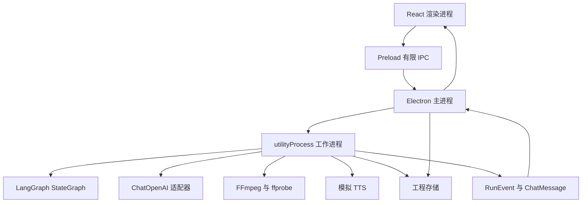
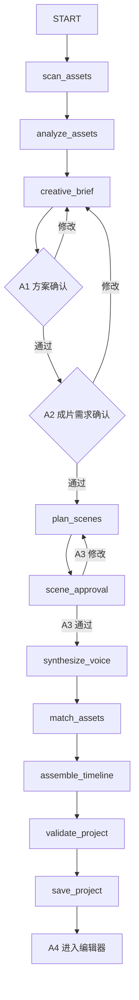

# 花生AI（妙剪 Magicut）桌面创作工具需求文档

| 项目 | 内容 |
| --- | --- |
| 文档版本 | v1.1 |
| 更新日期 | 2026-10-23 |
| 项目名称 | 花生AI（内部名）；产品名：妙剪 Magicut |
| 文档用途 | 行为、数据契约、后端工作流、媒体执行与验收基线 |
| 前端依据 | `docs/design/miaoma-magicut.pen`（唯一 UI 依据） |
| 首发环境 | Windows，本机单用户运行 |
| 项目定位 | 个人学习项目，独立实现 AI 视频创作桌面客户端 |

**文档约定**

- 原型负责“长什么样”，本文档负责“怎么动、存什么、怎么验收”。UI 布局、文案、控件位置不在这里重复；界面以原型为准。
- 若原型与本文档冲突：界面呈现以原型为准；行为、数据、持久化、错误处理与验收以本文档为准。
- “已确认”表示已选定；“实现默认值”表示首版采用的默认方案；“后续”表示首版之后的能力。
- 所有时间使用非负整数毫秒；导出按 30fps 量化。
- Zod 是数据定义来源；模型提交 Schema 从 Zod 导出，不手工维护多份定义。

## 目录

1. 产品目标与范围
2. 原型索引与用户流程
3. 技术栈与运行架构
4. 消息、产物与审批契约
5. 十节点后端工作流
6. LangGraph 调度、重试与恢复
7. 四轨时间线与媒体执行
8. 工程数据与保存恢复
9. 编辑器面板与快捷调整
10. 运行事件与界面映射
11. 任务、依赖与里程碑
12. 验收方案
13. 待验证事项与变更记录

## 1 产品目标与范围

### 1.1 产品目标

用户提供本地视频/图片素材、文稿、可选音乐和创作要求；智能体通过聊天消息流完成文稿分析、制作方案与成片需求确认，然后按四个用户可见阶段生成分镜、模拟配音和四轨工程。用户在编辑器中调整、预览并导出 MP4。

首版成功标准是完成以下闭环：

> 创建项目 → 导入本地素材与文稿 → 聊天式需求确认（方案、成片需求） → 四阶段生成（准备、分镜、配音、视频） → 分镜审批 → 四轨工程 → 编辑 → 保存恢复 → 预览 → 导出 16:9 MP4

### 1.2 已确认决策

| 编号 | 已确认事项 |
| --- | --- |
| D01 | 使用 Electron + TypeScript + React + Vite 开发独立客户端 |
| D02 | 首发 Windows，本机单用户运行；首版无登录、账号、计费或云端工程同步 |
| D03 | `docs/design/miaoma-magicut.pen` 是唯一前端依据；本文档只定义行为、数据与验收 |
| D04 | 后台工作流使用 LangGraph.js StateGraph；模型适配使用 LangChain.js `ChatOpenAI`；数据契约使用 Zod |
| D05 | 后端保留 10 个内部节点，用户只看到 4 个执行阶段：准备、创建分镜、配音生成、视频生成 |
| D06 | 首版导出 16:9、1920 × 1080、30fps、H.264 视频和 AAC 音频的 MP4 |
| D07 | 视频/图片素材由用户本地导入；首版不内置素材库 |
| D08 | 首版使用模拟 TTS；真实 TTS、音色克隆和参考音频后续接入 |
| D09 | 编辑器“快捷调整”首版只支持白名单意图，不做开放式自然语言剪辑 |
| D10 | 方案、成片需求和分镜必须由真实用户确认；模型不能代替用户审批 |
| D11 | 四轨为视频、配音、字幕、音乐；源视频原声默认静音；音乐由用户本地导入 |
| D12 | 字幕为句级字幕，固定基础样式加预设，导出时烧录 |
| D13 | 首版不做节点图 UI、可视化工作流编辑器和自由增删节点 |
| D14 | 首版只做已有素材的语义配画和基础剪辑，不做 MG 动画或生成式视频补画面 |

### 1.3 首版范围

- 首页/项目列表、创作页、聊天式创作消息页、四轨编辑器。
- 本地素材目录或文件导入；文稿粘贴或 UTF-8 TXT 导入；可选音乐导入。
- 素材扫描、ffprobe 元数据、关键帧提取、视觉模型内容索引。
- 文稿分析、纯口播稿转换、方案推荐、成片需求文档、分镜规划。
- 方案、成片需求、分镜三个人工确认点；支持修改反馈和版本失效。
- 模拟 TTS、句级字幕时间、四轨工程组装、校验与保存。
- 四轨编辑、时间线工具、画面/口播/字幕/音乐面板、白名单快捷调整。
- 自动保存、备份恢复、素材重新定位、预览、导出和 Windows 打包。
- 步骤状态、执行要点、校验错误、重试过程与失败原因展示。

### 1.4 非目标（v1）

- 真实 TTS、音色克隆、参考音频、自定义音色库。
- 上传口播音频、Whisper 对齐、逐字字幕微调。
- 推荐音乐库、AI 配乐、内置素材库。
- MG 动画、素材混合动效、生成式视频补画面。
- 竖屏 9:16、多画幅、转场特效、字幕样式编辑器高级能力。
- 多条同类轨道、复杂混音、专业多轨叠加。
- 节点图 UI、自由工作流编辑器、用户增删节点。
- 账号、云同步、多人协作、应用服务端密钥托管。
- 跨项目素材库与 SQLite 检索。

### 1.5 实现默认值

| 项目 | 首版默认值 |
| --- | --- |
| 视频格式 | MP4、MOV；H.264/AAC、SDR、CFR 为直接支持范围 |
| 特殊视频 | VFR、HEVC、HDR 统一转代理或明确拒绝，不静默出错 |
| 图片格式 | JPG、JPEG、PNG |
| 音乐格式 | MP3、WAV |
| 文稿输入 | 粘贴文本或 UTF-8 TXT；上限 10,000 字；首版必须提供文稿 |
| 目标输出 | 1920 × 1080，30fps，MP4，H.264 视频和 AAC 音频 |
| 画面适配 | 保持原始宽高比，使用留边补足 16:9 画布 |
| 字幕 | 句级字幕；最多 2 行；随包中文字体；导出烧录；支持预设样式 |
| 转场 | 直切；协议保留扩展能力 |
| 素材保存 | 引用原文件路径，默认不复制原视频和音乐 |
| 项目目录 | 默认 `Documents/妙剪`，可在设置中修改 |
| 云端输入 | 采样关键帧、文稿、素材分析摘要及创作设置 |
| TTS | 模拟提供者；输出静音占位 WAV 和明确标注的估算时间 |
| 模型调用上限 | 每视频最多 8 帧、长边 768、并发 2、单次运行最多 40 次调用、单请求最多 20 张图 |
| 音乐 | 本地导入；可选；循环或裁剪铺满项目；音量可调 |

原型中的竖屏 1080 × 1920 示例仅作为视觉参考；v1 交付规格统一为 16:9 1920 × 1080（D06），UI 文案中的竖屏/短视频表述需同步调整。

## 2 原型索引与用户流程

### 2.1 原型索引

| 原型 frame | 用途 | 本文档章节 |
| --- | --- | --- |
| 妙剪创作页 | 创作入口：文稿输入、音色选择、本地素材入口、创建 | §2.2、§9 |
| 妙剪创作消息页 | 聊天式创作、文稿分析、成片需求、4 个执行要点、视频概览 | §2.3、§4、§5 |
| 妙剪工作台 | 项目列表、最近项目、创建新作品 | §2.2 |
| 妙剪智能视频编辑器-画面 | 编辑器主界面、画面面板、上下文卡、快捷调整 | §7、§9 |
| 妙剪智能视频编辑器-口播 | 配音参数、音色、语速、音量 | §9.3 |
| 妙剪智能视频编辑器-字幕 | 字幕开关、字号、样式预设 | §9.4 |
| 妙剪智能视频编辑器-音乐 | 音乐开关、当前音乐、音量、曲库 | §9.5 |
| 右侧音乐设置区 | 音乐面板细节与状态 | §9.5 |

### 2.2 入口与项目

- **工作台**：项目卡片、最近项目、创建新作品、继续编辑；项目卡片展示标题、封面和更新时间。
- **创作页**：文稿输入/粘贴（0–10,000 字）、音色下拉（首版 4 个模拟音色）、本地素材导入入口、创建按钮。
- **项目创建**：默认保存到 `Documents/妙剪`，不弹出阻塞式目录选择；保存位置在设置中可改。
- **素材要求**：可以只带文稿创建草稿；启动生成前至少需要 1 个可用画面素材，否则聊天区提示补充。
- **模型设置**：API 地址、模型名、密钥、能力验证放在设置弹窗/抽屉，不占主流程页面。
- **导出**：编辑器顶部“渲染导出”打开导出弹窗，显示保存位置、固定输出参数、真实进度和取消。
- **上传口播音频**：原型中的标签页在首版隐藏或禁用；上传音频/Whisper 对齐属于 P1。
- **项目锁**：同一工程只允许一个窗口写入；第二个实例打开时提示占用或只读，避免双写覆盖。

### 2.3 聊天式创作流程

1. 用户在创作页输入文稿、可选创作要求、选择音色、导入本地素材，点击创建。
2. 工作进程开始 `scan_assets` 与 `analyze_assets`；聊天区可先显示素材扫描/分析状态。
3. 智能体输出 `script_analysis`：文稿类型、时间结构、转纯口播稿结果。
4. 智能体输出 `scheme_recommendation`：首版只推荐“素材匹配 + 基础剪辑（material_edit）”；用户确认或提出修改（A1）。
5. 智能体输出 `production_spec` 成片需求文档表格；用户确认或提出修改（A2）。
6. 4 个执行要点出现：01 准备、02 创建分镜、03 配音生成、04 视频生成；01 可显示为已完成。
7. 02 生成分镜后出现分镜审批卡；用户批准或请求修改（A3），修改回到 `plan_scenes`。
8. 03 生成模拟配音，界面明确标注“模拟”；不把估算时间标成真实时间戳。
9. 04 完成素材匹配、时间线组装、校验与保存，显示视频概览；用户点击进入编辑器（A4，非数据审批）。
10. 失败、重试、取消、等待审批都以内联消息和执行要点状态展示；重开工程后恢复。

审批点：

| 编号 | 确认对象 | 位置 | 作用 |
| --- | --- | --- | --- |
| A1 | 制作方案 | 聊天卡片 | 冻结首版方案；后续只允许 material_edit |
| A2 | 成片需求文档 ProductionSpec | 聊天表格卡片 | 冻结交付规格、风格、音色、字幕、节奏 |
| A3 | 分镜 ScenePlan | 聊天审批卡 | 批准后才允许配音和素材匹配 |
| A4 | 视频概览进入编辑器 | 完成卡片 | 进入编辑器的过渡动作，不是数据审批 |

- A1/A2/A3 都必须绑定版本与内容指纹；旧版本批准不能放行新版本。
- 修改 A1/A2 回到 `creative_brief`；修改 A3 回到 `plan_scenes`。
- 用户修改轮数单独记录，不计入网络重试次数。
- 模型不能代替用户提交有效审批；取消通过任务取消状态表达。

### 2.4 编辑器流程

- 打开项目后加载四轨工程、分镜列表、预览和右侧面板。
- 选中分镜或片段后显示上下文卡和“快捷调整”输入。
- 编辑轨道或面板参数后自动保存；预览读取当前修订；导出前重新校验。
- 关闭应用后重新打开，恢复轨道、面板状态、聊天记录和待审批状态。
- 增删分镜、重新规划等结构性修改不在编辑器快捷调整范围内；回到创作消息页提出修改，触发 A3 重新审批。

## 3 技术栈与运行架构

### 3.1 技术选型

| 模块 | 技术 | 职责 |
| --- | --- | --- |
| 桌面外壳 | Electron + TypeScript | 窗口、系统对话框、配置、工程生命周期 |
| 界面 | React + Vite | 创作页、聊天消息页、编辑器、预览、导出弹窗 |
| 结构化协议 | Zod | 节点输入输出、消息、产物、IPC 契约、JSON Schema 导出 |
| 工作流 | LangGraph.js StateGraph | 图编排、条件边、人工暂停、检查点、事件流、取消 |
| 模型适配 | LangChain.js `ChatOpenAI` | 图片输入、function calling、结构化输出 |
| 后台执行 | Electron utilityProcess | 承载 LangGraph、媒体子进程、模型与 TTS 调用 |
| 媒体工具 | 原生 FFmpeg、ffprobe | 元数据、关键帧、代理、字幕、混音与渲染 |
| TTS | 独立提供者接口 | 首版模拟实现；后续接真实服务 |
| 工程存储 | JSON + 本地文件夹 | 草稿、工程、消息、分析、生成文件、缓存、备份 |
| Windows 分发 | Electron Forge | 打包应用、媒体工具与字体，校验安装环境 |

首版不引入 React Flow；不做节点图 UI。自定义调度器不作为主方案，由 LangGraph 承担编排；保留 `NodeSpec` 领域契约，必要时可替换运行时。

### 3.2 进程与通信



- React 通过 Preload 暴露的有限 IPC 接口操作，不直接读文件系统或密钥。
- IPC 通道统一命名为 `模块:动作`（如 `settings:get`）；通道名、参数类型、返回值类型和错误结构集中在独立的 `shared/ipc-contract.ts`。
- 每个 IPC 通道只承担一个职责；不把应用信息、设置、媒体探测混在同一个接口。
- 主进程异常不直接抛给渲染进程；统一返回 `IpcResponse`：成功为 `{ ok: true, data }`，失败为 `{ ok: false, error: { code, message, retryable, details? } }`，不暴露原始异常、堆栈或文件路径。
- 主进程负责 `project.json` 写入协调、配置、密钥、任务启动和结果提交。
- 工作进程运行 LangGraph、模型调用、FFmpeg 和 TTS；只能写本运行专属的 `analysis/runs/<runId>/` 与 `generated/` 临时文件。
- 大文件通过路径引用传递，避免频繁经 IPC 复制媒体内容。
- 密钥由主进程 `safeStorage` 保存；工作进程按运行获取解密后的密钥，不写入工程、日志、模型提示或界面状态。
- 首版无独立云端业务后端。

### 3.3 LangGraph 运行约定

- 图使用 `StateGraph`；每个节点是 `NodeSpec` 的薄包装：Zod 输入 → execute → Zod 输出 → 业务校验 → 写产物 → 发事件。
- LangGraph state 只放 `projectId`、`runId`、`revision`、产物引用和状态；关键帧、媒体、完整消息、完整分镜不进 state。
- `graph.compile({ checkpointer })`；`thread_id = projectId:runId`；自定义 JSON checkpointer 写入 `analysis/runs/<runId>/checkpoints/`。
- 人工审批用 `interrupt()` 暂停、`new Command({ resume })` 恢复；审批前不做副作用。
- 事件通过节点包装器的领域事件发射器和 LangGraph `writer` 输出；UI 不直接依赖 LangGraph 内部事件名。
- `ChatOpenAI` 设置 `maxRetries: 0`；3 次模型尝试预算由自己的包装器管理，不叠加 LangGraph `retryPolicy`。
- 取消使用 `AbortSignal`；FFmpeg 子进程单独终止，Windows 上杀进程树。
- 显式设置 `recursionLimit`（例如 50），审批循环消耗的是图步数，不是重试次数。
- 锁定 `@langchain/langgraph`、`@langchain/core`、`@langchain/openai`、`@langchain/langgraph-checkpoint` 的精确版本；T02 验证 Electron 打包后再全面接入。

## 4 消息、产物与审批契约

### 4.1 ChatMessage

```ts
type ChatMessage = {
  id: string;
  projectId: string;
  runId?: string;
  role: "user" | "assistant" | "system";
  type: ChatMessageType;
  payload: unknown; // 按 type 定义具体 Zod Schema
  artifactRef?: string;
  relatedSceneIds?: string[];
  revision: number;
  status: "pending" | "completed" | "failed";
  createdAt: string;
};
```

| type | payload 主要内容 | UI 呈现 |
| --- | --- | --- |
| user_requirement | 文稿、创作要求、标签、音色 | 用户消息卡 |
| user_confirmation | gate、decision、feedback | 用户确认气泡 |
| script_analysis | 文稿类型、时间结构、摘要 | 分析消息卡 |
| script_rewrite | 纯口播稿、修改说明 | 文稿预览卡 |
| scheme_recommendation | 候选方案、推荐方案、理由 | 方案卡 + A1 |
| production_spec | ProductionSpec | 成片需求表格卡 + A2 |
| approval_request | gate、版本、指纹、摘要 | 审批卡 |
| execution_update | phase、node、status、progress | 执行要点 |
| video_overview | 时长、风格、音色、导出状态 | 视频概览卡 + A4 |
| error | 错误码、消息、是否可重试 | 错误卡 |
| system_notice | 提示文本 | 通知条 |

- 消息追加写入 `messages.json`，按序号/时间排序，支持分页和重开恢复。
- 消息不包含密钥；不把模型内部推理文本作为产品输出。
- 旧消息不因后续版本变化而删除；审批卡状态单独记录。

### 4.2 核心产物

| 产物 | 主要内容 | 版本/指纹 |
| --- | --- | --- |
| AssetManifest | 素材 ID、路径、类型、大小、修改信息、扫描问题 | manifestVersion |
| AnalyzedAssetCollection | 元数据、关键帧、内容描述、标签、失败素材 | analysisVersion |
| CreativeBrief | 主题、受众、风格、时长、核心信息、叙事结构、覆盖问题 | briefVersion |
| ProductionSpec | 成片需求文档字段 | specVersion + fingerprint |
| ScenePlan | 分镜版本、场景、旁白、预计时长、问题 | scenePlanVersion + fingerprint |
| ApprovalResult | gate、decision、版本、指纹、反馈、时间 | approvalId |
| AssetMatchCollection | 场景候选、入出点、排序、理由、未匹配项 | matchVersion |
| VoiceSegmentCollection | 场景音频、时长、字幕时间、timingSource、isMock | voiceVersion |
| VideoProject | 四轨片段、引用、设置、问题、修订号 | contentRevision |
| ValidationReport | validatedRevision、passed、errors、warnings | revision |
| SavedProjectRef | 工程路径、工程 ID、修订号、保存时间 | revision |

### 4.3 ProductionSpec（成片需求文档）

| 字段 | 说明 |
| --- | --- |
| videoType | 视频类型/用途；v1 为 16:9 横屏 |
| recommendedScheme | 首版固定 `material_edit`；MG 动画等不支持 |
| visualStyle | 视觉风格 |
| palette | 配色 |
| font | 字幕/画面字体；必须映射到随包字体 |
| voiceProfile | 音色；首版映射到模拟音色 |
| subtitleStyle | 字幕样式预设 |
| materialStrategy | 素材策略 |
| rhythm | 节奏结构 |
| deliverySpec | 1920×1080、30fps、H.264/AAC、MP4、16:9 |
| aspectRatio | `16:9` |
| resolution | `1920x1080` |
| fps | `30` |
| durationRange | 目标时长范围 |
| sourceAudioMuted | `true` |

- A2 批准后冻结 specVersion 与内容指纹；分镜、配音、组装、导出都引用该版本。
- 模型若返回不支持的方案（如 MG 动画），归一化为 `material_edit` 并显示说明，不静默改变用户预期。
- 原型中的竖屏交付示例不进入 v1 ProductionSpec。

### 4.4 审批规则

- A1/A2/A3 未批准时，下游节点不得启动。
- 审批绑定 gate、artifactVersion、contentFingerprint、runId、时间、反馈。
- 文稿、创作要求、方案、spec 或分镜变化后，旧审批失效；旧批准不能放行新版本。
- 请求修改返回对应生产节点，保留反馈、旧版本和可复用素材分析。
- 应用关闭后恢复 `waiting_user`；启动时不自动重新发起收费调用，由用户选择继续或重试。
- 取消通过任务取消状态表达；取消后不自动启动新请求。
- A4 只是“进入编辑器”的过渡，不冻结数据；编辑器内的修改按内容修订处理。

### 4.5 创建聊天与编辑器聊天

- 创建聊天：项目级消息、A1/A2/A3 审批、执行要点、视频概览；支持提出分镜修改。
- 编辑器聊天：场景级“快捷调整”，只接受白名单 EditIntent；不支持结构性修改。
- 两者独立持久化；编辑器聊天消息必须带 `relatedSceneIds`。
- 编辑器聊天不支持时，助手明确回复支持范围，不静默改工程。

## 5 十节点后端工作流

### 5.1 阶段映射

| 用户可见阶段 | 内部节点 | 说明 |
| --- | --- | --- |
| 01 准备 | scan_assets、analyze_assets、creative_brief | creative_brief 内含 A1/A2；A2 后 01 可显示已完成 |
| 02 创建分镜 | plan_scenes、scene_approval | A3 审批；修改回到 plan_scenes |
| 03 配音生成 | synthesize_voice | 模拟 TTS；先于素材匹配 |
| 04 视频生成 | match_assets、assemble_timeline、validate_project、save_project | A4 在保存后进入编辑器 |

节点 6（素材匹配）不再与节点 7（配音）并行。先得到模拟/真实配音时长，再确定素材入出点，避免真实 TTS 接入后匹配结果系统性偏短或偏长。若后续要并行，改为两阶段匹配：先召回候选，TTS 完成后再定时。

### 5.2 节点契约

| 节点 | 输入 | 输出 | 关键约束 |
| --- | --- | --- | --- |
| scan_assets | 素材目录/文件、格式配置 | AssetManifest | 递归扫描；稳定 assetId；去重；不可读文件单独记录；无画面素材提示 |
| analyze_assets | AssetManifest、采样配置、模型配置 | AnalyzedAssetCollection | ffprobe + 关键帧 + 视觉模型；按素材复用；失败素材不冒充已分析 |
| creative_brief | 文稿、创作要求、素材分析摘要、项目设置 | CreativeBrief + ProductionSpec | A1/A2 中断；不编造事实；只推荐 material_edit；spec 冻结 |
| plan_scenes | CreativeBrief、ProductionSpec、文稿、旧版本/反馈 | ScenePlan | 分镜版本化；原文可追溯；只使用直切；预计时长；待处理问题 |
| scene_approval | ScenePlan | ApprovalResult | A3；绑定版本/指纹；未批准下游不启动；修改返回节点 4 |
| synthesize_voice | 已批准分镜、模拟配置、音色/语速 | VoiceSegmentCollection | 静音 WAV；估算时间；isMock；不声称真实时间戳 |
| match_assets | 已批准分镜、配音时长、素材索引 | AssetMatchCollection | 真实 assetId；入出点不越界；时长不足标记问题；不擅自拉伸 |
| assemble_timeline | 分镜、匹配、配音、音乐、设置 | VideoProject | 以配音时长排布；图片静态片段；原声静音；不静默覆盖人工编辑 |
| validate_project | VideoProject、内容修订号 | ValidationReport | Zod + 业务校验；报告绑定修订；缺失素材/覆盖不足阻止导出 |
| save_project | VideoProject、通过的校验报告 | SavedProjectRef | 原子写盘；失败保留上一份；成功后进入视频概览 |

### 5.3 图与时序



- A1/A2 是 `creative_brief` 节点内的两次 `interrupt()`；图中画成门，便于阅读。resume 会重跑节点，因此 interrupt 前只做只读计算和校验，不写副作用。
- A3 是 `scene_approval` 节点内的 `interrupt()`；批准后通过条件边/`Command` 进入 `synthesize_voice`。
- 分镜修改通过条件边返回 `plan_scenes`；用户反馈保存在 state/产物中。
- `recursionLimit` 显式设置，审批循环不能依赖默认值。
- 节点 8 等待节点 7 的配音时长；不存在 6/7 并行分支。

### 5.4 LangGraph state

| 字段 | 说明 |
| --- | --- |
| projectId / runId | 工程与运行标识 |
| contentRevision | 当前内容修订号 |
| assetManifestRef | AssetManifest 文件引用 |
| analysisRef | 素材分析引用 |
| briefRef / specRef | 简报与成片需求引用 |
| scenePlanRef | 当前分镜版本引用 |
| approvalRefs | A1/A2/A3 审批记录引用 |
| voiceRef | 配音产物引用 |
| matchRef | 素材匹配引用 |
| projectRef | VideoProject 引用 |
| validationRef | 校验报告引用 |
| phaseStatus | 4 个阶段状态 |
| lastEventSeq | 事件序号 |
| errorRefs | 错误记录引用 |

state 只存引用和状态；完整产物、消息、媒体在工程目录。state Schema 单独版本化，不与节点 Zod Schema 混用。

## 6 LangGraph 调度、重试与恢复

### 6.1 运行与状态

| 状态 | 来源/含义 |
| --- | --- |
| pending | 等待依赖或尚未启动 |
| running | 节点正在执行 |
| waiting_user | `interrupt()` 等待真实用户 |
| succeeded | 节点输出通过校验并提交检查点 |
| failed | 预算耗尽或永久错误 |
| cancelled | 用户取消或 AbortSignal |
| interrupted | 应用关闭/进程中断；重开后标记，不能视为完成 |

- 结果另记 `current` 或 `stale`；输入改变导致结果过期，不等于执行失败。
- 应用启动时不自动重跑；恢复已完成的节点和 `waiting_user`，原 `running` 标记 `interrupted`，由用户选择继续或重试。
- 通过最后事件时间/心跳判断中断；LangGraph 检查点本身不区分“关闭”和“失败”。

### 6.2 重试预算

- 默认总尝试次数 3，包含首次；网络重试和 Schema 修复共享同一预算。
- `ChatOpenAI` 必须设置 `maxRetries: 0`；不使用 `OutputFixingParser` 等额外模型调用。
- LangGraph `retryPolicy` 只允许用于基础设施错误（如 FFmpeg 进程异常），不得再套模型/业务重试；否则会放大调用次数。
- 每个模型请求使用一个 `AttemptBudget`，记录网络、结构修复、业务修复的尝试。

| 错误类型 | 行为 |
| --- | --- |
| 网络暂时故障、可重试限流、临时服务错误 | 预算内指数退避 + 抖动；遵守 Retry-After |
| 参数/输出结构不合法 | 返回字段路径与原因，要求模型修正；计入预算 |
| 模型引用不存在素材/越界片段 | 业务校验错误回传；不修改真实素材事实迁就输出 |
| 密钥错误、权限不足、素材缺失、磁盘不足 | 停止自动重试，定位到可操作问题 |
| 模型拒绝、用户取消、等待审批 | 停止或保持状态，不盲目修复 |
| TTS 提交后超时且结果未知 | 先查询任务/缓存；无法确认时展示状态，不重复提交 |

手动重试创建新尝试记录，复用输入未变的成功子任务；取消后不自动发起新请求。

### 6.3 审批与恢复

- `interrupt` payload 只放 gate、artifactId、版本、内容指纹、摘要和 UI 需要的引用；完整产物由 UI 从工程存储读取，避免检查点膨胀。
- resume 后先校验审批版本/指纹；不匹配则拒绝并重新进入等待或返回生产节点。
- interrupt 前的代码在 resume 时重跑；所有副作用必须幂等，或放到 resume 之后。
- 审批等待状态和检查点写入 `analysis/runs/<runId>/`；不是可清缓存。
- 重开工程恢复消息流、执行要点、审批卡和检查点；不依赖上次窗口的临时状态。
- 多个审批点串行；并行审批不在首版范围。

### 6.4 幂等、失效与并发

- 每次运行记录输入指纹、Schema 版本、模型/提供者配置版本和产物引用；输入未变且产物有效时复用。
- 工程写入排队；旧快照不能覆盖新修订；同一工程只允许一个窗口写入。
- 文件先生成到任务专属临时路径，提交成功后再关联工程；保存重试不重复生成配音或重跑整条流程。
- 内容修订变化使校验、导出和下游派生结果失效；运行状态写入不改变内容修订。
- 人工编辑不被后台静默覆盖；重新生成前展示替换范围或要求确认。

## 7 四轨时间线与媒体执行

### 7.1 轨道能力

| 轨道 | 首版能力 |
| --- | --- |
| 视频 | 视频/图片片段；移动、排序、裁剪、替换；源视频原声静音；每个分镜一个片段；图片按分镜时长静态显示 |
| 配音 | 模拟语音片段；按分镜对齐；音量、语速；重新生成当前分镜；显示“模拟”标记；允许停顿空隙；不重叠 |
| 字幕 | 句级文本与时间；编辑内容和显示区间；显示开关；字号与预设样式；允许空隙；不重叠 |
| 音乐 | 本地导入；开关；移动/裁剪/循环；音量；可选；允许空隙 |

- 首版每种轨道一条；不提供多轨叠加、转场和特效。
- 时间线工具：撤销/重做、播放头分割、吸附、联动、波形、缩放。
- 快捷调整只改当前工程，不直接操作底层文件。

### 7.2 时间线不变量

- 项目总时长 = 各分镜时长之和 = 配音轨结束时间。
- 分镜时长以配音片段时长为准；未生成配音前使用 ScenePlan 的预计时长。
- 视频轨从 0 到项目结束连续覆盖；每个分镜一个片段；片段时长 = 分镜时长；无空隙。
- 素材可用长度不足时标记 `INSUFFICIENT_COVERAGE`，阻止导出；不自动变速、不循环拉伸。
- 素材更长时裁剪到分镜时长；图片片段时长 = 分镜时长。
- 配音片段从分镜起点开始，时长 = 音频时长；停顿可表达为空隙或独立片段，首版按空隙处理。
- 字幕在分镜范围内，允许句间空隙，不允许重叠或超出项目时长。
- 音乐可选，允许空隙；循环/裁剪后覆盖项目范围；音量独立。
- 只支持直切；视频片段首尾相接。
- 任何编辑提升 `contentRevision`，并使校验、导出、下游派生结果变为 stale。
- 人工编辑优先；重新生成必须确认替换范围。

### 7.3 媒体处理

- ffprobe 提取时长、分辨率、帧率、编码、旋转、音频参数；导出加 `-autorotate`。
- VFR/HEVC/HDR 素材：按需转代理或明确拒绝；v1 不保证直接播放/导出。
- 关键帧：每视频最多 8 帧，长边 768；视觉输入使用 base64 data URL；按内容哈希缓存。
- 代理：按需生成 960×540、H.264/AAC、30fps；缓存可重建；H.264/AAC MP4/MOV 可直接预览。
- 字幕：随包 Noto Sans SC 等中文字体；ASS + `fontsdir`；最多 2 行、每行 16–20 字、底部安全区；预设样式映射到 ASS。
- 音频：统一采样率；源视频原声静音；配音与音乐在导出时混音；AAC 192kbps。
- 路径：`spawn` 使用参数数组，不拼 shell；正确处理中文、空格路径；取消/退出杀 ffmpeg 进程树。
- FFmpeg 构建、版本与分发许可在 T06 选定并记录；开发/打包路径必须统一抽象。
- 模型调用上限：8 帧/视频、长边 768、并发 2、单次运行最多 40 次调用、单请求最多 20 张图；启动前显示预计调用数。

### 7.4 预览与导出

- 预览：单个 `<video>`（静音）承载视频轨，两个 `<audio>` 承载配音和音乐，DOM 叠加字幕；`requestAnimationFrame` 做主时钟；seek 后统一设置 `currentTime`；漂移超过 50ms 校正。
- 预览读取当前 `VideoProject`；编辑后使预览缓存失效；缺失素材显示占位和问题提示。
- 导出前重新校验当前内容修订，不能复用修改前的通过报告。
- 渲染由本地代码把 VideoProject 编译为 FFmpeg 参数；模型不提交任意 Shell 命令。
- 输出固定 16:9 1920×1080 30fps H.264/AAC MP4；字幕烧录；音乐混音。
- 使用 `-progress pipe:1` 读取真实进度；先写临时文件，成功后重命名；取消/失败不展示成功成品，清理临时文件。
- 预览与导出使用同一份时间线数据；不允许两套时间计算。

## 8 工程数据与保存恢复

### 8.1 工程目录

```text
项目/
├── project.json                 工程头、输入、素材引用、spec、分镜、四轨时间线、设置
├── messages.json                创作聊天与编辑器聊天消息（追加写）
├── analysis/
│   ├── assets/                  素材清单、分析结果
│   ├── matches/                 素材匹配结果
│   ├── approvals/               审批记录
│   └── runs/<runId>/            运行事件、检查点、错误记录
├── generated/                   模拟配音及其他生成文件
├── cache/                       缩略图、关键帧、代理文件（可重建）
└── backups/                     最近 3 份有效工程备份
```

- 原素材不默认复制进工程；引用原文件路径。
- `analysis/` 与 `generated/` 中的有效结果属于工程数据，不能当作普通缓存清理。
- `cache/` 清理后应能重建预览资源，不触发已完成的云端分析。

### 8.2 核心数据

| 数据 | 主要内容 |
| --- | --- |
| 工程头 | schemaVersion、projectId、contentRevision、名称、创建/修改时间 |
| 原始输入 | 文稿、创作要求、素材清单、音乐选择、项目设置 |
| 制作产物 | CreativeBrief、ProductionSpec、ScenePlan、审批记录 |
| 时间线 | 四轨片段 ID、assetId、时间线位置、入出点、文字、音量、字幕样式 |
| 运行记录 | runId、节点状态、输入指纹、尝试次数、产物引用、错误 |
| 消息 | ChatMessage 列表、审批卡状态、执行要点 |
| 导出 | 输出设置、当前校验状态引用 |

### 8.3 保存与恢复

- 创建工程时初始化结构合法草稿；默认目录 `Documents/妙剪`。
- 停止编辑 2 秒后自动保存；持续编辑最多间隔 30 秒；Ctrl+S 立即保存。
- AI 节点完成、审批状态变化时提交检查点。
- 同一工程写操作排队；先写临时文件，成功后再替换；保留最近 3 份有效备份。
- 失败时保留上一份有效工程和尚未保存的内存编辑，展示失败原因。
- 损坏工程可从有效备份恢复；高版本工程不被旧应用覆盖。
- 素材丢失不阻止打开；重新定位保留原 assetId 与时间线关联，不按同名文件自动替换。
- 应用更新不得覆盖用户工程目录。
- 同一工程只允许一个窗口写入；第二个实例提示占用或只读。
- 检查点 schemaVersion 与当前应用不兼容时，提示并允许重新运行，不静默读取。

### 8.4 配置与密钥

- 应用级设置和最近项目列表放在 Electron userData 的专用子目录。
- 密钥由主进程使用 `safeStorage` 保存；不进入工程、消息、模型提示、节点快照、普通日志或界面状态。
- 工作进程按运行获取解密密钥；运行结束不持久化。
- 正常界面只显示“已配置”状态，不完整回显密钥。
- 首版无账号、无服务端密钥托管。
- LangSmith/LangChain 外部追踪默认关闭；如开启，必须由用户明确配置。

## 9 编辑器面板与快捷调整

### 9.1 布局与原型控件范围

编辑器以原型为准：顶部品牌/工程/自动保存/渲染导出；左侧分镜字幕列表；中间预览；右侧窄功能栏（画面/口播/字幕/音乐）+ 面板；底部时间线与轨道。

原型控件在 v1 的行为：

| 原型控件 | v1 行为 |
| --- | --- |
| 上传口播音频标签页 | 隐藏或禁用；P1 |
| 参考音频、音色克隆、自定义音色库 | 禁用，显示“后续”提示 |
| IndexTTS2 标签 | 显示“模拟 TTS”或当前提供者名称 |
| Whisper 已对齐/逐字微调 | 改为“模拟时间/句级微调” |
| 推荐音乐库 | 隐藏；本地导入；P1 |
| 竖屏 1080×1920 文案 | 改为 16:9 1920×1080 |
| 节点图 | 不实现 |
| 创作倾向 | v1 仅“AI 智能创作”；手动模式 P1 |
| 智能匹配素材 | v1 唯一画面模式；素材替换用轻量本地选择器 |

### 9.2 画面面板

- 上下文卡显示当前分镜、文稿片段、视频画面、配音、创作倾向标签。
- `creationMode` 首版固定 `ai`；手动模式 P1，不显示为可选项。
- 画面模式首版固定“智能匹配素材”。
- 素材替换：通过片段右键/属性面板打开本地素材选择器弹窗；原型未画该弹窗，视觉沿用原型卡片风格。
- 快捷调整输入框与当前分镜关联；不选择分镜时默认当前选中项。

### 9.3 口播面板

- 音色：温婉学姐、新闻播报、沉稳男声、活力讲解；每个音色有 `voiceId`、展示名、描述和模拟参数。
- 音量 0–100%；语速 0.8–1.2x；生成/重新生成当前分镜。
- 首版所有音色输出静音占位 WAV；界面显示“模拟”标记；估算时间不标成真实时间戳。
- 参考音频上传、音色克隆、自定义音色库禁用；不伪造试听结果。
- 修改音色/语速会改变估算时长，进而使素材匹配、组装和校验结果 stale；素材覆盖不足时提示，不自动变速。

### 9.4 字幕面板

- 显示开关；字号 24–72；原型 7 个样式预设；应用到当前字幕轨。
- 首版一个字幕轨；样式保存在工程设置中，导出映射为 ASS。
- 句级文本与显示区间可编辑；不做逐字时间微调。
- 允许句间空隙；不允许重叠或超出项目时长。
- 字幕内容与分镜、文稿保持关联；修改文本不自动重写文稿，除非用户明确要求。

### 9.5 音乐面板

- 开关、当前音乐、音量、导入、移除、应用、裁剪/循环。
- 首版只有本地导入；推荐曲库和分类隐藏，P1。
- 音乐可选；关闭后不生成音乐轨；允许空隙。
- 引用的音乐文件丢失时，校验报错；用户可重新定位或移除。
- 音量独立于配音；导出时混音。

### 9.6 快捷调整（EditIntent）

输入：自然语言文本 + 当前分镜/轨道 + `baseRevision`。

流程：`withStructuredOutput(EditIntentSchema)` → Zod/业务校验 → 检查 `baseRevision` → 确定性执行 → 提升内容修订 → 使校验/导出 stale → 写入撤销记录 → 助手确认消息。

| 意图 | 参数 | 效果 |
| --- | --- | --- |
| change_voice | voiceId | 更换当前分镜音色并重新生成模拟配音 |
| set_voice_volume | volume 0–100 | 调整配音轨音量 |
| set_voice_speed | speed 0.8–1.2 | 调整语速并重算分镜时长 |
| shorten_scene | sceneId、deltaMs | 缩短分镜；检查视频覆盖 |
| extend_scene | sceneId、deltaMs | 延长分镜；检查素材长度 |
| replace_asset | sceneId、assetId、inPointMs? | 替换视频片段；需本地素材选择器确认 |
| edit_subtitle | sceneId、text | 修改字幕文本 |
| set_subtitle_style | styleId、fontSize?、visible? | 修改字幕样式 |
| set_music | assetId、volume?、loop? | 更换/调整音乐 |
| regenerate_voice | sceneId | 重新生成当前分镜模拟配音 |

- 首版一条消息只处理一个意图；多意图或歧义时要求用户拆分/确认。
- 不支持的结构性修改（增删分镜、重新规划）明确提示回到创作消息页，不静默执行。
- `baseRevision` 过期时拒绝并提示重试；不覆盖新编辑。
- 所有快捷调整进入撤销/重做栈；模型不直接改文件、不执行 Shell。

### 9.7 时间线工具

- 撤销/重做至少 20 步；播放头分割；吸附到播放头/片段边缘；联动；波形；缩放。
- 快捷键：空格播放/暂停、Delete 删除、Ctrl+Z/Ctrl+Y、Ctrl+S。
- 支持选择片段、移动、排序、裁剪、替换、查看属性。
- 禁止负时长、越界片段、重叠片段。
- 任何编辑使当前校验/导出结果 stale；导出前重新校验。
- 分镜结构变更不在编辑器完成，回到创作消息页。

## 10 运行事件与界面映射

### 10.1 事件字段

运行事件至少包含：`runId`、`nodeId`、`seq`、`inputRevision`、`status`、`attempt`、`timestamp`、`progressType`、`current`、`total`、`artifactRef`、`errorSummary`；按素材/分镜拆分时增加 `assetId` 或 `sceneId`。

- FFmpeg 使用实际进度；批处理显示已完成数/总数；模型等待没有可靠百分比时显示等待与已耗时，不伪造进度。
- 重试显示尝试次数和原因。
- 事件写入 `analysis/runs/<runId>/events.jsonl` 供恢复与排错；UI 主要读取持久化消息和节点状态。
- 重开工程由持久化状态重建界面，不依赖上次窗口临时状态。

### 10.2 阶段与消息映射

| 执行要点 | 数据来源 | 展示 |
| --- | --- | --- |
| 01 准备 | scan_assets、analyze_assets、creative_brief | 素材数量、分析状态、spec 摘要 |
| 02 创建分镜 | plan_scenes、scene_approval | 分镜数量、版本、审批卡 |
| 03 配音生成 | synthesize_voice | 配音片段、模拟标记、时长 |
| 04 视频生成 | match_assets、assemble_timeline、validate_project、save_project | 轨道构建、错误定位、视频概览 |

- 用户只看到 4 个阶段；10 个节点是内部实现。
- 阶段状态使用 pending/running/waiting_user/succeeded/failed/cancelled/interrupted 的用户友好文案。
- 聊天消息类型与 UI 卡片按 §4.1 映射；审批卡、成片需求表、执行要点、视频概览都来自持久化消息。

### 10.3 不做节点图

- 首版不实现 React Flow、节点图、步骤流调试 UI 或自由工作流编辑器。
- 用户可见进度 = 创作消息流 + 4 个执行要点。
- 开发期可从 LangGraph 导出 Mermaid 图用于文档/排错，不进入产品界面；如以后需要调试视图，放 P2。

## 11 任务与里程碑

完整任务拆分、依赖、预估和验收标准见 `花生AI_妙剪Magicut_任务清单_v1.1.md`；本文档不再重复。

- 技术验证：T01、T02。
- 工程基础：T03–T07。
- 聊天流程：T08–T16。
- 编辑与交付：T17–T20。
- 打包验收：T21。
- 关键路径：T01 → T02 → T03 → T04 → T05 → T06 → T08 → T09 → T10 → T11 → T12 → T13 → T14 → T15 → T17 → T18 → T19 → T21。

## 12 验收方案

### 12.1 基准样例

- 3 段短视频（至少一段非 16:9，验证留边）、1 张图片、一篇中文文稿（6–8 个分镜，30–90 秒）、1 首音乐。
- 1 个损坏文件、1 个可被移动的文件。
- 首版使用模拟 TTS；真实配音质量在接入真实服务后单独验收。
- 在 Windows 11 上验收；最终在无开发环境的目标机运行。

### 12.2 功能验收

| 编号 | 场景 | 预期结果 |
| --- | --- | --- |
| A01 | 完整闭环 | 创建/导入 → 聊天确认 → 4 阶段 → 分镜审批 → 编辑器 → 导出 16:9 MP4 |
| A02 | A1/A2/A3 审批门 | 未确认方案/需求/分镜时，下游不启动；消息与审批状态持久化 |
| A03 | 修改反馈 | 产生新版本；旧审批失效；素材分析不重复执行；重新审批 |
| A04 | 旧版本审批提交 | 被拒绝或提示版本已变化，下游不执行 |
| A05 | 结构化输出错误 | Zod 拦截，预算内修复；未验证结果不进入时间线 |
| A06 | 业务校验失败 | 素材 ID 不存在、越界、覆盖不足被拦截并定位；导出被阻止 |
| A07 | 网络限流/暂时故障 | 展示原因，最多 3 次；遵守等待时间；可取消 |
| A08 | 审批/执行中关闭应用 | 重开恢复审批；中断执行标记 interrupted；不自动重新收费调用 |
| A09 | 保存失败/损坏 | 旧工程仍可打开；内存未保存内容保留；备份可恢复；高版本不被覆盖 |
| A10 | 素材移动/丢失 | 工程可打开并标缺失；重新定位保留 assetId 与时间线关联 |
| A11 | 模拟 TTS | 静音占位、明确模拟标记；估算时间不被当作真实时间戳 |
| A12 | 快捷调整 | 白名单意图正确执行；不支持意图明确拒绝；撤销可用；旧修订被拒绝 |
| A13 | 导出取消/失败 | 不显示成功；临时文件清理；进度真实 |
| A14 | 输出与混音 | 1920×1080 30fps H.264/AAC；源声静音；字幕样式正确；音乐音量正确 |
| A15 | 安全与打包 | 工程/日志/提示无密钥；LangGraph 在打包应用中运行；无 ESM/CJS 错误 |

### 12.3 媒体与非功能验收

- 导出文件可由常用播放器正常播放；分辨率、帧率、编码符合 D06。
- 片段边界相对量化后的时间线误差不超过一个输出帧；预览字幕与配音起点偏差不超过 100ms，完整播放无明显累计漂移。
- 视频与图片保持比例，字幕完整显示，音乐音量和原声静音符合工程。
- 扫描、分析、代理和渲染期间窗口保持可交互；取消可反馈状态。
- 不将整个原视频一次读入内存；关键帧按任务处理；同一工程写入有序。
- 工程、消息、日志、流程事件和模型请求快照不包含 API 密钥。
- 无开发环境的目标 Windows 可安装运行；FFmpeg 与字体路径有效。
- 应用更新不覆盖用户工程目录。

### 12.4 验证分层

- Vitest 覆盖 Schema、时间线不变量、重试预算、审批版本/指纹、checkpointer 序列化、EditIntent 执行器。
- 模型调用使用可控假实现覆盖错误路径；再用真实 API 验证图片和工具调用能力。
- 桌面端使用基准样例做完整验收；打包后做一次冷启动/恢复/导出冒烟。

## 13 待验证事项与变更记录

### 13.1 待验证事项

| 事项 | 当前状态 | 处理时点 |
| --- | --- | --- |
| 现有 API 的供应商、模型名、图片限制 | 已确认支持图片；具体配置待提供 | T08 |
| function calling、指定函数、strict 支持 | 尚未实测；不支持时降级 jsonMode + 本地 Zod | T08 |
| LangGraph/LangChain 版本与 Electron ESM 打包 | 已锁定 `@langchain/langgraph 1.5.2`、`@langchain/core 1.2.20`、`@langchain/openai 1.5.0`（1.6.x 要求 Node >= 22）、`@langchain/langgraph-checkpoint 1.2.1`；待 T02 验证打包 | T02 |
| 自定义 JSON checkpointer 的序列化与并发 | 接口可行，需实测；失败则退回自定义调度器 | T02、T07 |
| FFmpeg 构建、版本、分发许可 | 待选定并记录 | T06、T21 |
| 中文字幕字体与预设映射 | 待选字体并验证 ASS 渲染 | T06、T19 |
| 模拟 TTS 估算规则 | 待定；建议按中文字符数 + 标点停顿 + 语速系数，写进测试 | T12 |
| Windows 最低版本与基准硬件 | 待记录 | T21 |
| 真实 TTS、上传口播/Whisper、推荐曲库、竖屏、MG 动画 | 首版不做 | P1/P2 |

### 13.2 变更记录

**v1.1（2026-10-23）**

- 以 `docs/design/miaoma-magicut.pen` 为唯一前端依据；创作流程改为聊天消息流 + 4 个执行要点，删除节点图/React Flow/步骤流 UI。
- 10 个节点保留为后端实现，映射到准备、创建分镜、配音生成、视频生成；调度改为 LangGraph.js + LangChain.js + 自定义 JSON checkpointer。
- 确定 16:9 1920×1080 30fps、本地素材、模拟 TTS、白名单快捷调整。
- 新增 ChatMessage、ProductionSpec、EditIntent、A1–A4 审批和原型控件范围表。
- 删除独立执行/审批/素材/设置/导出页，以及真实 TTS、音色克隆、上传口播/Whisper、推荐曲库、竖屏、MG 动画等首版非目标。
- 删除讨论历史与重复验收；任务清单独立成文件。

**v1.0（2026-10-22）**

- 初始需求基线；前端与流程章节由 v1.1 取代。

### 13.3 技术参考

- 原型文件：`docs/design/miaoma-magicut.pen`
- LangGraph.js Interrupts：https://docs.langchain.com/oss/javascript/langgraph/interrupts
- LangGraph.js Fault tolerance：https://docs.langchain.com/oss/javascript/langgraph/fault-tolerance
- LangGraph.js Event streaming：https://docs.langchain.com/oss/javascript/langgraph/event-streaming
- LangGraph.js Checkpointers：https://docs.langchain.org.cn/oss/javascript/langgraph/checkpointers
- LangChain.js Structured output：https://js.langchain.ac.cn/docs/how_to/structured_output/
- Electron utilityProcess：https://www.electronjs.org/docs/latest/api/utility-process
- Electron safeStorage：https://www.electronjs.org/docs/latest/api/safe-storage
- FFmpeg 文档：https://www.ffmpeg.org/ffmpeg.html
