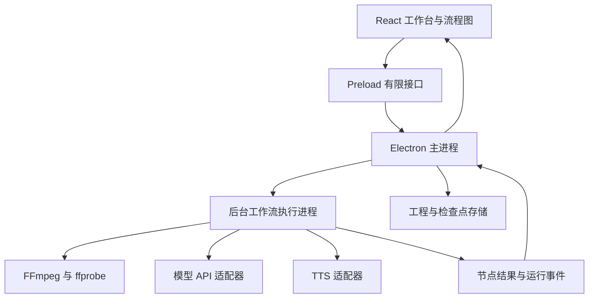
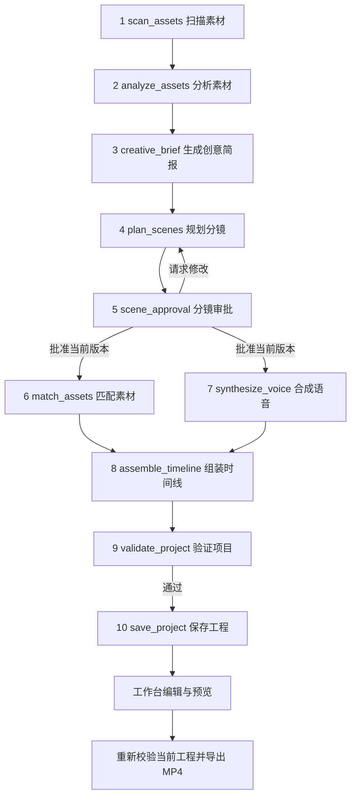

# 花生 AI 桌面创作工具需求文档

| 项目 | 内容 |
| --- | --- |
| 文档版本 | v1.0 |
| 更新日期 | 2026 年 10 月 22 日 |
| 项目名称 | 花生 AI 桌面创作工具，暂定名称 |
| 文档用途 | 统一产品需求、技术实现边界、任务依赖与验收标准 |
| 首发环境 | Windows，本机单用户运行 |
| 项目定位 | 个人学习项目，独立实现 AI 视频创作桌面客户端 |

本文将讨论形成的产品需求整理为实现基线。应用接受本地素材和用户文稿，通过具有结构化输入输出的 10 节点工作流生成可编辑工程；用户在四轨工作台中调整，预览后导出 MP4。首版使用模拟 TTS，真实语音服务后续选择。

“已确认”表示讨论中明确选定的事项；“实现默认值”表示为便于开发采用的具体默认方案；“后续”表示首版之后的能力。尚待验证的服务能力不视为已经实现或确认可用。

## 目录

1. 产品目标与范围
2. 用户流程与界面需求
3. 技术栈与系统职责
4. 十节点智能体工作流
5. 结构化协议与模型调用
6. 调度 重试与人工审批
7. 四轨时间线与媒体执行
8. 工程数据与保存恢复
9. 可视化与运行事件
10. 可执行任务与依赖
11. 验收方案
12. 待验证事项与决策记录
13. 技术参考

## 1 产品目标与范围

### 1.1 产品目标

用户提供视频素材、文稿及可选音乐，应用理解素材内容和创作要求，规划分镜并请求用户审批。审批后匹配素材、生成配音占位和字幕，组装四轨工程，供用户继续剪辑。AI 执行过程以步骤流和节点图展示。

首版成功标准是完成以下闭环：

> 创建工程 → 导入素材与文稿 → AI 分析与分镜规划 → 用户审批 → 生成四轨工程 → 编辑 → 保存与恢复 → 预览 → 导出 MP4

### 1.2 已确认的产品决策

| 编号 | 已确认事项 |
| --- | --- |
| D01 | 使用 Electron + TypeScript + React + Vite 开发独立客户端，独立实现创作流程 |
| D02 | 首发 Windows，近期用于个人学习与本机运行 |
| D03 | 首版不提供登录、账号、计费或云端工程同步 |
| D04 | 本地进行媒体预处理，云端 AI 理解关键帧和文稿 |
| D05 | 已有支持图片输入的 OpenAI 兼容 API；工具调用等能力仍需接入验证 |
| D06 | 提供视频、配音、字幕、音乐四条轨道，支持实际编辑、预览与导出 |
| D07 | AI 过程同时提供步骤流和节点图 |
| D08 | 文稿用于生成旁白；首版先使用模拟 TTS，后续评估火山引擎或本地 TTS |
| D09 | 背景音乐由用户导入，源视频原声默认静音 |
| D10 | 首版导出 16:9、1080p MP4 |
| D11 | 智能体包含 10 个节点，各节点输入输出结构化，采用 function calling、Zod 校验及有上限的自动重试 |
| D12 | 分镜生成后必须经过用户审批，支持提出修改意见并返回分镜规划 |

### 1.3 首版范围

- 扫描本地目录与导入素材，接受视频、图片和音频。
- 粘贴文稿或导入 TXT，填写可选创作要求。
- 提取媒体元数据、镜头范围及关键帧，通过视觉模型生成内容索引。
- 生成创意简报、结构化分镜、候选镜头及初始四轨工程。
- 对分镜执行人工审批，保存审批版本及反馈。
- 编辑、自动保存、工程恢复、预览、导出及 Windows 打包。
- 显示节点状态、阶段结果、校验错误、重试过程和失败原因。

### 1.4 首版边界与后续能力

首版以已有素材的语义配画和基础剪辑为重点。图片输入扩展来源于 10 节点方案，首版按静态画面片段处理。

以下能力安排在后续：真实 TTS、本地 TTS、多画幅、转场特效、字幕样式编辑、多条同类轨道、复杂混音、AI 配乐、原视频语音理解、精细连续动作理解和跨项目素材库。

首版不进行生成式视频补画面。缺少合适素材时展示待处理状态，由用户补充或调整。

### 1.5 实现默认值

| 项目 | 首版默认值 |
| --- | --- |
| 视频格式 | MP4、MOV，以选定 FFmpeg 构建实际可解码为准 |
| 图片格式 | JPG、JPEG、PNG |
| 音乐格式 | MP3、WAV |
| 文稿输入 | 粘贴文本、UTF-8 TXT；首版要求提供文稿 |
| 目标输出 | 1920 × 1080，30 fps，MP4，H.264 视频和 AAC 音频 |
| 画面适配 | 保持原始宽高比，使用留边补足画布 |
| 字幕 | 句级字幕，固定基础样式，导出时烧录 |
| 转场 | 直切；分镜协议保留扩展能力 |
| 素材保存 | 引用原文件路径，默认不复制原视频和音乐 |
| 云端输入 | 采样关键帧、文稿、素材分析摘要及创作设置 |
| TTS | 模拟提供者，输出静音占位音频和明确标注的估算时间 |

这些默认值属于实现基线，不代表用户已经选定具体音色、模型供应商或所有导出参数。

## 2 用户流程与界面需求

### 2.1 主流程

1. 用户创建工程并选择工程保存目录。
2. 选择素材目录或导入文件，粘贴或导入文稿，添加可选音乐与创作要求。
3. 配置模型地址、模型名称和密钥，验证图像与工具调用能力。
4. 启动工作流，查看素材扫描、分析、创意简报和分镜规划的状态。
5. 在分镜审批界面查看、编辑或提出反馈；批准当前分镜版本。
6. 查看素材匹配和模拟配音生成；系统组装并验证工程。
7. 在四轨工作台调整片段、文字和音乐，预览后导出。
8. 关闭应用后重新打开工程，继续编辑。

### 2.2 主要界面

| 界面 | 必要内容与操作 |
| --- | --- |
| 工程入口 | 创建工程、打开工程、最近工程列表 |
| 素材与文稿 | 素材列表、缩略图、元信息、缺失提示、文稿编辑、创作要求、音乐导入 |
| AI 执行视图 | 步骤流、10 节点图、当前任务、耗时、尝试次数、结果摘要、取消与重试 |
| 分镜审批 | 分镜顺序、画面需求、旁白、预计时长、版本、反馈、批准、请求修改 |
| 剪辑工作台 | 素材库、预览区、四轨时间线、片段属性和问题定位 |
| 模型设置 | API 地址、模型、密钥配置、能力验证、TTS 提供者及模拟状态 |
| 导出界面 | 保存位置、固定首版输出参数、实际渲染进度、取消和结果路径 |

首版节点图用于观察预设工作流和操作节点。用户自由增删节点、重连执行逻辑的通用工作流编辑器属于后续扩展。

## 3 技术栈与系统职责

### 3.1 技术选型

| 模块 | 技术 | 职责 |
| --- | --- | --- |
| 桌面外壳 | Electron + TypeScript | 窗口、系统对话框、配置、工程生命周期 |
| 界面 | React + Vite | 素材管理、文稿、审批、四轨编辑器、预览 |
| 流程图 | React Flow | 自定义节点、依赖连线、状态及阶段产物展示 |
| 结构化协议 | Zod | 输入输出校验、TypeScript 类型推导、JSON Schema 生成 |
| 调度器 | TypeScript 固定依赖工作流 | 节点执行、并发、重试、审批暂停、检查点、失效判断 |
| 后台执行 | Electron utilityProcess | 承载工作流执行和后台任务，隔离耗时或易失败处理 |
| 媒体工具 | 原生 FFmpeg、ffprobe | 元数据、分镜采样、关键帧、代理文件、混音与渲染 |
| 模型调用 | OpenAI 兼容 API 适配器 | 图像理解、创意简报、分镜规划、素材匹配 |
| TTS | 独立提供者接口 | 模拟实现，后续接火山或本机服务 |
| 工程存储 | JSON + 本地文件夹 | 草稿、工程、分析结果、生成文件、缓存、备份 |
| Windows 分发 | Electron Forge | 打包应用和媒体工具，校验安装环境 |

### 3.2 进程与通信



- React 通过 Preload 暴露的有限 IPC 接口发起操作，不直接读取文件系统或密钥。
- 主进程负责工程读写协调、配置访问、任务启动和结果提交。
- 后台进程负责调度工作流及调用媒体子进程、模型、TTS。
- 后台任务返回产物引用与状态，主进程统一提交工程修订，避免多个节点并发修改同一工程文件。
- 图片、音频等大文件通过文件引用传递，避免频繁经 IPC 复制完整媒体内容。
- 首版无需额外部署独立云端业务后端。真实本地 TTS 服务可在后续作为独立适配器接入。

## 4 十节点智能体工作流

### 4.1 节点依赖



节点 6 和 7 在审批通过后可以并行执行。组装时间线等待二者完成，并以配音时长为依据。节点 10 完成后得到可编辑工程；预览和 MP4 导出是工作台动作。

### 4.2 scan_assets 扫描素材

- **输入**：用户授权选择的素材目录、支持格式配置、手动导入文件清单。
- **职责**：递归扫描目录，识别视频、图片和音频；建立稳定素材 ID；记录不可读文件及跳过原因。
- **输出 AssetManifest**：素材 ID、原始路径、文件名、类型、大小、修改信息，以及扫描问题列表。
- **验收**：嵌套目录可扫描；同一工程重复导入不产生重复素材记录；单个不可读文件不阻断其他文件；没有可用画面素材时提示用户补充。

### 4.3 analyze_assets 分析素材

- **输入**：AssetManifest、抽帧配置、视觉模型配置引用。
- **职责**：ffprobe 提取视频时长、分辨率、帧率及编码；提取音频时长、采样率及声道；读取图片尺寸；视频进行镜头切换采样与补充采样；视觉模型理解代表帧。
- **输出 AnalyzedAssetCollection**：媒体元数据、带时间位置的镜头和关键帧引用、内容描述、主体、动作及场景标签，以及失败素材清单。
- **执行方式**：本地媒体处理与视觉模型调用组合。视频按片段处理，图片直接作为静态视觉素材分析。原视频音频的转写与语义分析安排在后续。
- **验收**：描述可以追溯到真实素材及时间范围；元数据来自媒体工具；不能把损坏或未分析成功的素材当作可用结果；已完成素材分析可单独复用。

### 4.4 creative_brief 生成创意简报

- **输入**：用户要求、原始文稿、素材分析摘要、画幅和时长等项目设置。
- **职责**：理解主题、目标受众、风格、核心信息与叙事结构；判断素材是否基本覆盖文稿。
- **输出 CreativeBrief**：主题、受众、风格基调、目标时长、核心信息、叙事结构及素材覆盖问题。
- **验收**：原始文稿保留；素材不足形成明确问题；不生成未经用户要求的事实性补充作为原文。

### 4.5 plan_scenes 规划分镜

- **输入**：CreativeBrief、原始文稿、已有分镜及用户反馈。
- **职责**：将文稿细化为可执行分镜，建立画面需求、旁白对应和预计时长。
- **输出 ScenePlan**：分镜版本、场景 ID、顺序、关联文稿段落、画面描述、旁白、预计时长、直切设置、镜头建议和待处理问题。
- **验收**：文稿内容可追溯；场景顺序明确；首版只使用可执行的直切；修改后生成新版本；用户明确要求改写文稿时保留修改记录供审批。

### 4.6 scene_approval 分镜审批

- **输入**：ScenePlan、分镜版本及审批展示信息。
- **职责**：持久化等待状态；展示分镜；接受用户批准、修改反馈或取消。
- **输出 ApprovalResult**：approved 或 revise、分镜版本、内容指纹、反馈和操作时间。取消通过任务取消状态表达。
- **执行方式**：由真实用户操作提交，通过 IPC 进入调度器；模型不能代替用户生成有效审批。
- **验收**：未批准时节点 6 和 7 不启动；请求修改返回节点 4；关闭应用后可继续等待审批；旧版本的批准不能放行新版本。

### 4.7 match_assets 匹配素材

- **输入**：已批准的分镜快照、素材内容索引及媒体元数据。
- **职责**：为分镜检索候选视频片段或图片，综合语义、画面覆盖和重复使用情况提出建议。
- **输出 AssetMatchCollection**：场景 ID、候选素材 ID、建议入点和出点、排序、简短匹配理由、匹配程度及未匹配项。
- **验收**：素材 ID 必须存在；时间范围不能越界；依据可追溯到已分析的素材；无合适候选时明确未匹配；预计时长不足时提示调整，不擅自拉伸视频。

### 4.8 synthesize_voice 合成语音

- **输入**：已批准的分镜旁白、TTS 提供者配置、音色和语速参数。
- **职责**：按场景或句段生成音频，取得时长及服务可提供的时间戳。
- **输出 VoiceSegmentCollection**：场景 ID、音频文件引用、时长、字幕时间信息、timingSource、isMock 和提供者信息。
- **首版实现**：模拟 TTS 根据固定估算规则生成静音占位 WAV 和句级预计时间；界面明确显示模拟状态。
- **验收**：无真实 TTS 密钥也能贯通流程；音频文件与预计时长一致；不会将估算时间标成真实语音时间戳；后续提供者可以替换而不重写时间线模块。

### 4.9 assemble_timeline 组装时间线

- **输入**：已批准分镜、匹配结果、配音片段、音乐选择和项目设置。
- **职责**：用确定性本地逻辑安排视频、配音、字幕和音乐，建立统一时序与来源引用。
- **输出 VideoProject**：四轨片段、源文件引用、文稿与分镜关联、问题列表、输出设置及项目修订号。
- **验收**：使用真实配音时以实际时长排布；模拟模式使用估算时长；图片按场景时长形成静态片段；音乐可选；源视频原声默认静音；不静默覆盖人工编辑。

### 4.10 validate_project 验证项目

- **输入**：VideoProject 及其内容修订号。
- **职责**：执行 Zod 结构校验及本地业务校验，包括文件存在性、素材范围、关联 ID、时间值、视频覆盖、字幕和音轨范围。
- **输出 ValidationReport**：validatedRevision、passed、errors、warnings；每个问题含错误码、位置、相关场景或片段 ID 和修复提示。
- **验收**：缺失素材、无效 ID、越界片段、必需画面未匹配等问题阻止工程进入可导出状态；音乐和字幕允许合理空隙，不要求所有轨道始终连续；校验只对同一工程修订有效。

### 4.11 save_project 保存工程

- **输入**：VideoProject、同一修订号的通过校验结果、目标工程位置。
- **职责**：提交已验证的生成工程快照，并记录此次工作流结果。
- **输出 SavedProjectRef**：工程路径、工程 ID、修订号、保存时间。
- **验收**：实际写盘成功后才显示保存成功；写入失败保留上一份有效工程；重开后四轨、原始引用及 AI 结果一致。

**保存边界**：节点 10 是一次生成流程的完成提交。节点检查点、审批等待状态和用户编辑草稿在流程中持续保存；存在待修复业务问题的草稿仍应允许保存。

## 5 结构化协议与模型调用

### 5.1 Schema 作为数据定义来源

每个节点定义 InputSchema 和 OutputSchema，由 Zod 推导 TypeScript 类型。需要模型输出的节点从相应的提交 Schema 导出 JSON Schema，不手工维护三份独立定义。

模型协议使用可序列化的基础类型。日期采用字符串、时间采用数字，避免向模型 Schema 中直接放入函数、文件句柄、Date、Map 或运行时转换逻辑。工程中的时间统一使用非负整数毫秒，导出时按 30 fps 量化边界。

示意接口如下，实际字段通过需求中的节点契约细化：

```typescript
type NodeSpec<I, O> = {
  id: NodeId;
  inputSchema: ZodType<I>;
  outputSchema: ZodType<O>;
  execute(input: I, context: NodeContext): Promise<O>;
};
```

公共上下文包含 runId、节点 ID、输入版本、工作目录、取消信号、事件发射器和配置访问能力。密钥和媒体二进制不进入可视化输入输出快照。

### 5.2 Function calling 的使用范围

- analyze_assets 的视觉理解、creative_brief、plan_scenes、match_assets 使用模型结构化提交。
- scan_assets、assemble_timeline、validate_project、save_project 由本地代码执行，输入输出同样进行 Zod 校验。
- scene_approval 使用真实用户输入；synthesize_voice 使用提供者适配器。
- 调度器按依赖安排执行，在每个模型节点仅开放本阶段所需函数，例如 submit_scene_plan。
- 模型提交的工具参数通过校验后才进入节点输出。function calling 不替代工具实际执行结果的校验。

### 5.3 三层校验

| 层级 | 检查内容 | 失败处理 |
| --- | --- | --- |
| 调用约束 | 是否调用正确函数，是否返回完整参数 | 在预算内重试或结构修复 |
| Zod 结构校验 | 字段、类型、枚举、必填值和基础数值范围 | 返回字段路径及原因，要求修正 |
| 业务校验 | 素材存在、场景关联、时间越界、审批版本及实际可执行性 | 可修正的模型错误进入修复；环境或素材问题交给用户处理 |

### 5.4 兼容 API 能力验证

接入时验证图片输入、function calling、指定函数调用和 strict Schema 的支持情况。已有图片能力不代表其他能力已经确认。

支持严格模式时优先启用 strict，并生成符合提供者支持子集的 Schema。若支持工具调用但不支持严格模式，界面明确显示采用本地强校验模式；若没有工具调用能力，提示更换配置，不静默改成不受控自由文本执行。

## 6 调度 重试与人工审批

### 6.1 调度方式

使用 TypeScript 实现固定依赖工作流。节点 6、7 在审批通过后可并行，节点 8 等待二者结果。视频分析在节点内部按素材或片段拆成子任务，允许保留已成功子任务。

单个节点执行顺序为：

> 校验输入 → 检查缓存与输入版本 → 记录开始 → 执行 → 校验输出 → 校验业务约束 → 保存结果和检查点 → 发出完成事件 → 放行后继节点

### 6.2 执行状态

| 状态 | 含义 |
| --- | --- |
| pending | 等待依赖或尚未启动 |
| running | 正在执行 |
| waiting_user | 等待真实用户审批或补充处理 |
| succeeded | 输出验证并提交完成 |
| failed | 已失败，需要处理或重试 |
| cancelled | 用户主动取消 |
| interrupted | 应用关闭或进程中断，不能视为已完成 |

结果另外记录 current 或 stale。输入改变导致结果过期，不等于过去那次执行发生失败。

### 6.3 重试规则

**默认总尝试次数为 3，包含首次调用。** 网络重试和 Schema 修复共享此预算，避免嵌套重试放大调用次数。SDK 内置重试必须计入预算或关闭重复重试层。

| 错误类型 | 自动行为 |
| --- | --- |
| 网络暂时故障、可重试限流、临时服务错误 | 在预算内指数退避并加入抖动；遵守 Retry-After |
| 参数或输出结构不合法 | 将具体校验错误和必要上下文返回模型，要求修正 |
| 模型引用不存在素材或越界片段 | 在预算内返回业务校验错误修复，不修改真实素材事实来迁就输出 |
| 密钥错误、权限不足、素材缺失、磁盘空间不足 | 停止自动重试，定位到可操作问题 |
| 模型拒绝、用户取消、等待审批 | 停止或保持对应状态，不进行盲目修复重试 |
| TTS 提交后超时，是否已生成未知 | 优先查询任务或缓存；无法确认时展示状态，避免直接重复提交 |

手动重试创建新的尝试记录，但复用输入未变的成功子任务。用户取消后，不自动启动新的请求。

### 6.4 审批与修改

- 审批记录绑定 scenePlanVersion 与内容指纹。
- 修改分镜、旁白或相关创作要求后，旧审批失效。
- 请求修改返回 plan_scenes，保留用户反馈、旧版本和可复用的素材分析。
- 用户修改正在执行的版本时，相关后续任务取消或过期；旧结果不得覆盖新内容。
- 人工审批循环与自动错误修复分别记录。用户修改轮数不作为网络重试次数。
- 已有人工调整的工程重新生成时，先展示建议或明确确认替换范围，再应用结果。

### 6.5 可恢复与幂等

每次运行记录输入指纹、Schema 版本、模型或提供者配置版本及产物引用。输入未变且产物有效时复用完成结果。

重开工程后恢复已完成节点及 waiting_user 状态；原 running 节点标为 interrupted。首版由用户选择继续或重试，不在启动应用时自动重新发起收费请求。

文件生成使用任务专属路径或临时文件，提交成功后再关联工程。保存节点重试不应重复生成已完成配音或再次执行整条 AI 流程。

## 7 四轨时间线与媒体执行

### 7.1 轨道与编辑能力

| 轨道 | 首版能力 |
| --- | --- |
| 视频 | 视频及静态图片片段；移动、排序、裁剪、替换素材；源视频原声默认静音 |
| 配音 | 显示按场景生成的音频、时长与模拟标记；可定位、重新生成相关片段 |
| 字幕 | 显示句级文本与时间；编辑内容和显示区间；与分镜及文稿保持关联 |
| 音乐 | 用户导入；移动、裁剪、调整音量；选择裁剪或循环覆盖项目范围 |

工作台支持播放、暂停、定位播放头、选择片段、查看属性和定位问题。首版每种轨道提供一条轨道，专业多轨叠加和特效后续扩展。

### 7.2 时间依据

- 有真实 TTS 时，实际音频时长决定旁白片段长度；提供者有时间戳时优先使用。
- 模拟 TTS 时，音轨、字幕和分镜使用同一套估算时间，并明确标记。
- 更换真实 TTS 后重新计算受影响时间，不直接替换音频文件而保留旧排时。
- 视频片段不足以覆盖分镜时提示调整或替换；首版不自动改变视频播放速度。
- 无合适素材、必需画面空缺或素材丢失时，工程仍可编辑保存，导出前要求修复。

### 7.3 预览与导出

预览和导出读取同一份 VideoProject 时间线。预览可使用本地代理视频，以 React 和浏览器媒体元素进行播放、字幕叠加及音频同步；最终渲染将同一份时间线编译为 FFmpeg 参数。

导出前重新校验当前项目修订，不能复用修改前的通过报告。媒体命令由本地代码根据结构化工程生成，模型不提交任意 Shell 命令。

导出显示真实渲染进度。渲染完成后才将临时文件提交为最终 MP4；取消或失败时不将未完成文件展示为成功结果。

## 8 工程数据与保存恢复

### 8.1 工程目录

```text
我的视频项目/
├── project.json       文稿 素材引用 四轨时间线 设置和任务索引
├── analysis/          持久化素材分析 匹配结果 审批与节点检查点
├── generated/         配音及其他工程所需生成文件
├── cache/             可重建的缩略图 关键帧和代理文件
└── backups/           最近三份有效工程备份
```

原素材不默认复制进工程。analysis 和 generated 中的有效结果属于工程数据，不能作为普通临时缓存一并清理。清理 cache 后应能恢复预览所需资源，不触发已完成的云端分析。

### 8.2 核心工程数据

| 数据 | 主要内容 |
| --- | --- |
| 工程头 | schemaVersion、projectId、contentRevision、名称、创建与修改时间 |
| 原始输入 | 文稿、创作要求、素材清单、音乐选择和项目设置 |
| 素材引用 | 固定 assetId、路径、媒体类型、元数据、存在状态及分析引用 |
| 分镜与审批 | 分镜版本、场景关联、批准的内容指纹、反馈 |
| 时间线 | 四轨片段 ID、素材 ID、时间线位置、素材入出点、文字和音量 |
| AI 运行记录 | runId、节点状态、输入指纹、尝试次数、产物和错误引用 |
| 生成文件引用 | 音频等生成文件的工程内相对路径及有效性 |
| 导出设置 | 画幅、分辨率、帧率和当前校验状态引用 |

调度元数据的写入不应无故改变剪辑内容修订。validate_project 绑定的是内容修订，避免仅记录运行状态就使校验结果失效。

### 8.3 保存与恢复要求

- 创建工程时选择保存位置，初始化结构合法的草稿。
- 停止编辑 2 秒后自动保存；持续编辑时最多间隔 30 秒保存；Ctrl+S 立即保存。
- AI 节点完成、审批状态变化时及时提交检查点。
- 同一工程的写操作排队，防止旧快照覆盖新修订。
- 先写临时文件并确认成功，再替换正式文件；保留最近 3 份有效备份。
- 失败时保留上一份有效工程和尚未保存的内存编辑，展示失败原因。
- 损坏工程可选择有效备份恢复；高于当前支持格式版本的工程不允许被旧应用覆盖。
- 素材丢失不阻止工程打开；用户重新定位后保留原 assetId 及时间线关联，不按同名文件直接自动替换。
- 应用更新不得覆盖用户工程目录。

### 8.4 配置与密钥

应用级设置和最近工程列表放在 Electron userData 的专用子目录。密钥由主进程使用系统加密能力保存，不进入项目、模型提示、节点快照、普通日志或界面状态。

用户在界面可以替换密钥，正常回显只展示已配置状态。首版无需账号或应用服务端密钥托管。

## 9 可视化与运行事件

### 9.1 展示内容

步骤流与 React Flow 节点图读取同一份运行状态。10 个主节点保持清晰，素材分析、配音等大量子任务在节点详情中展开，避免把每个关键帧都变成主图节点。

| 阶段 | 用户能看到的信息 |
| --- | --- |
| 扫描与分析 | 当前素材、已完成数量、元数据、关键帧、分析摘要和失败素材 |
| 创意与分镜 | 当前阶段、耗时、结构化简报、分镜版本与旁白 |
| 人工审批 | 等待状态、当前版本、反馈和批准操作 |
| 匹配与配音 | 场景、候选片段、简短匹配依据、音频和模拟标记 |
| 组装与校验 | 轨道构建状态、错误片段定位和修复建议 |
| 保存与导出 | 保存状态、工程位置；独立渲染任务的实际进度和输出位置 |

可视化展示操作步骤、输入输出摘要与证据，不将模型内部推理文本作为产品输出。

### 9.2 事件字段

运行事件至少包含 runId、nodeId、事件序号、输入版本、状态、attempt、时间、进度类型、结果引用和错误摘要。按素材拆分时增加 assetId 或 sceneId。

- FFmpeg 使用实际进度；批处理显示已完成数和总数。
- 模型等待没有可靠百分比时展示等待和已耗时，不伪造精确进度。
- 重试显示尝试次数及原因。
- 重开工程后由持久化状态重建界面，不依赖上次窗口中的临时状态。

## 10 可执行任务与依赖

P0 表示首版必须完成，P1 表示首版之后优先完善，P2 表示后续扩展。下列任务编号在文档内固定使用。

### 10.1 P0 工程基础与运行框架

| ID | 可执行任务 | 依赖 | 验收标准 |
| --- | --- | --- | --- |
| T01 | 创建 Electron React TypeScript Vite 项目，配置开发与 Windows 打包 | 无 | 桌面窗口可启动，React 热更新可用，生成的应用包能够启动 |
| T02 | 定义 10 节点、工程、轨道、审批、事件和错误的 Zod Schema 与 IPC 契约 | T01 | 每个节点有输入输出类型及正反样例；Schema 能用于结构校验；模型提交 Schema 可导出 |
| T03 | 实现工程仓库和基础读写，保存 AI 产物引用及草稿 | T02 | 创建、保存、关闭重开后内容一致；格式版本正确；不存在工程内密钥泄漏 |
| T04 | 实现自动保存、写入队列、备份、损坏恢复与素材重新定位 | T03 | 满足 2 秒自动保存和持续编辑最多 30 秒保存；写入失败保留旧工程；备份可恢复；重新定位保留时间线关联 |
| T05 | 实现 scan_assets、目录扫描、文件导入、文稿输入和素材去重 | T03 | 可扫描嵌套目录；支持约定格式；单个失败有记录；重复导入不重复建档 |
| T06 | 实现 ffprobe 元数据、分镜采样、关键帧和预览代理生成 | T05 | 后台处理不阻塞界面；元数据可核对；损坏文件单独失败；缓存可重建 |
| T07 | 实现调度器、节点状态、取消、结果提交、检查点和输入失效机制 | T02、T03 | 模拟 10 节点可执行；依赖顺序正确；断点恢复和过期结果拦截可验证 |
| T08 | 实现 API 配置、能力验证、function calling、三层校验和统一重试预算 | T02、T07 | 图片和工具调用能力被实际验证；错误输出不流入下游；总尝试不超过 3 次；密钥与永久错误不盲目重试 |

### 10.2 P0 十节点业务执行

| ID | 可执行任务 | 依赖 | 验收标准 |
| --- | --- | --- | --- |
| T09 | 完成 analyze_assets 的视觉分析，持久化片段描述和内容索引 | T06、T08 | 分析可追溯到素材和时间；成功子任务可复用；失败素材不冒充已分析 |
| T10 | 完成 creative_brief 和 plan_scenes，关联原文与分镜版本 | T08、T09 | 简报与分镜结构合法；原文可追溯；新分镜版本可区分；待处理问题明确 |
| T11 | 完成 scene_approval 界面、暂停恢复、反馈回路及版本校验 | T07、T10 | 审批前匹配和 TTS 均不启动；修改返回节点 4；重开仍可审批；旧批准无法放行新版本 |
| T12 | 完成 match_assets 候选匹配、范围检查和匹配摘要 | T08、T09、T11 | 候选使用真实素材 ID；越界结果被拦截；无匹配及长度不足明确展示 |
| T13 | 完成 synthesize_voice 接口、模拟音频和句级字幕时间 | T07、T11 | 无真实 TTS 可运行；输出音频时长与估算一致；模拟标记贯穿工程和界面 |
| T14 | 完成 assemble_timeline，将分镜、素材、配音、字幕与音乐转成四轨工程 | T12、T13 | 时间依据统一；图片可用；原声静音；人工编辑不会被后台静默覆盖 |
| T15 | 完成 validate_project 和 save_project 的生成工程提交 | T03、T14 | 校验定位到具体片段；报告绑定内容修订；通过后成功落盘；失败仍可保留草稿 |

### 10.3 P0 工作台与交付

| ID | 可执行任务 | 依赖 | 验收标准 |
| --- | --- | --- | --- |
| T16 | 实现步骤流与 React Flow 节点图、阶段详情、重试入口 | T07 | 两视图状态一致；显示输入输出摘要与尝试次数；用户等待和真实进度表达正确 |
| T17 | 实现四轨编辑器、视频裁剪替换、文稿字幕编辑及音乐调节 | T04、T15 | 编辑可保存恢复；不能生成负时长和越界片段；相关派生结果正确标为需更新 |
| T18 | 实现播放暂停、定位、视频代理、字幕与音频同步预览 | T06、T17 | 预览读取当前时间线；编辑后画面声音变化正确；缺失素材可定位 |
| T19 | 实现导出前重校验、FFmpeg 渲染、进度、取消与 MP4 提交 | T15、T18 | 输出符合 1080p 30fps H.264 AAC；渲染可取消；失败不显示成功；缺失画面阻止导出 |
| T20 | 完成 Windows 包、FFmpeg 随包路径和整体验收 | T01 至 T19 | 无开发环境的目标 Windows 能运行；完整闭环通过；用户工程不受安装或更新覆盖 |

### 10.4 里程碑与关键路径

| 里程碑 | 完成条件 |
| --- | --- |
| M1 工程可保存 | T01 至 T06 完成，支持导入、预处理、保存恢复和重新定位 |
| M2 工作流框架可运行 | T07、T08、T16 完成，模拟节点可观察、可恢复、可重试 |
| M3 AI 可生成工程 | T09 至 T15 完成，分镜审批后生成并保存四轨工程 |
| M4 可剪辑可交付 | T17 至 T20 完成，预览导出与 Windows 独立运行通过 |

主要业务路径为：

> T01 → T02 → T03 → T05 → T06 → T09 → T10 → T11 → T12 与 T13 → T14 → T15 → T17 → T18 → T19 → T20

T09 同时依赖 T08；T08 依赖 T07。自动保存 T04、模型配置与执行框架、过程可视化 T16 可以在契约确定后并行推进。并行表示模块开发关系，不要求采用多智能体开发。

### 10.5 P1 与 P2

| ID | 优先级 | 任务 | 依赖 | 验收标准 |
| --- | --- | --- | --- | --- |
| E01 | P1 | 接入真实 TTS，优先评估火山引擎 | T13、T18 | 真实音频替换占位并重新排时；使用可用时间戳；缺少字词时间戳时支持按句段时长对齐；费用和错误状态可解释 |
| E02 | P1 | 改进素材候选、重复镜头控制与人工选择 | T12、T17 | 可预览切换候选、保留人工选择，并能评估匹配改善 |
| E03 | P1 | 加固长任务恢复和提供者任务查询 | T07、T08 | 已完成子任务可复用；未知执行状态可查询；不重复提交已有产物 |
| E04 | P2 | 接入本地 TTS 服务 | T13 | 本地服务可配置；不可用时提示启动方法；替换提供者无需重写工作台 |
| E05 | P2 | 竖屏、复杂字幕、转场及高级音轨 | T17 至 T19 | 预览与导出遵循同一效果数据，并增加对应验收样例 |
| E06 | P2 | 跨项目素材库与检索 | 工程存储和素材索引 | 再评估 SQLite 与索引方案，保持现有工程可迁移 |

## 11 验收方案

### 11.1 基准样例

使用自有或可用的 3 段短视频、一张图片、一篇中文文稿及一首音乐。准备横竖比例不同的素材、一个损坏文件和一个可被移动的文件，覆盖正常与异常情况。

首版用模拟 TTS 验收结构、时间和渲染；真实配音质量在接入真实服务后单独验收。

### 11.2 功能验收

| 编号 | 场景 | 预期结果 |
| --- | --- | --- |
| A01 | 从创建工程到导出 | 10 节点按依赖运行，审批后生成四轨；用户编辑后可导出 MP4 |
| A02 | 审批前等待 | 匹配与 TTS 不启动；无审批超时默认通过 |
| A03 | 反馈后重新规划 | 产生新分镜版本并保留反馈；素材分析不重复执行；需要重新审批 |
| A04 | 旧版本审批提交 | 被拒绝或提示版本已变化，下游不执行 |
| A05 | function calling 返回错字段或错类型 | Zod 拦截，在预算内修复，未验证结果不进入时间线 |
| A06 | 结构正确但素材 ID 不存在或范围越界 | 业务校验拦截并定位错误，可修复时回传模型 |
| A07 | 网络限流或暂时故障 | 展示重试原因，最多 3 次；遵守等待时间并可取消 |
| A08 | 密钥错误或模型拒绝 | 停止自动重试，显示具体原因 |
| A09 | 审批或执行中关闭应用 | 重开恢复审批状态；中断执行被识别，不自动重新收费调用 |
| A10 | 保存时写入失败 | 旧工程仍可打开，内存未保存内容仍保留，用户得到失败提示 |
| A11 | 工程损坏和格式不兼容 | 可恢复有效备份；高版本工程不被旧应用覆盖 |
| A12 | 原素材被移动 | 工程打开且标缺失；重新定位恢复同一时间线关联 |
| A13 | 缓存清理 | 本地重建缩略图和代理，不删除生成配音或触发已完成云端分析 |
| A14 | 模拟 TTS | 音频为静音占位且有明确标记，估算时间不会被当作真实时间戳 |
| A15 | 改文稿或分镜 | 关联结果过期，旧审批失效；旧任务结果不覆盖新编辑 |
| A16 | 音乐为空或字幕有间隔 | 合法工程可通过，不将可选音轨空隙误判为错误 |
| A17 | 人工编辑后再次生成 | 先展示替换影响或要求确认，人工结果不被静默覆盖 |
| A18 | 导出中取消或失败 | 进程停止或错误明确，未完成文件不作为成品显示 |

### 11.3 媒体与非功能验收

- 导出文件确认为 1920 × 1080、30 fps、H.264/AAC MP4，可由常用播放器正常播放。
- 导出片段边界相对量化后的时间线误差不超过一个输出帧；预览字幕与配音起点在基准样例中偏差不超过 100 毫秒，完整播放无明显累计漂移。这些是验收目标，尚非实测结论。
- 视频与图片保持比例，字幕完整显示，音乐音量和原声静音设置符合工程。
- 扫描、分析、代理和渲染期间窗口保持可交互；取消操作可反馈状态。
- 不将整个原视频一次读入内存；关键帧按任务处理；同一工程写入有序。
- 工程、普通日志、流程事件和模型请求快照不包含 API 密钥。
- 无开发环境的目标 Windows 可以安装并运行，媒体二进制路径有效。

### 11.4 建议验证分层

实现时优先验证高风险边界：Schema 和业务约束、审批版本、重试预算、结果失效、文件写入恢复。模型调用使用可控假实现覆盖错误路径，再以真实 API 验证图片与工具调用能力。最终使用基准样例执行桌面端完整验收。

## 12 待验证事项与决策记录

### 12.1 不阻断框架开发的待验证事项

| 事项 | 当前状态 | 处理时点 |
| --- | --- | --- |
| 现有 API 的供应商、模型名称、图片请求限制 | 已确认支持图片，具体配置待提供或读取本机配置 | T08 接入验证 |
| function calling、指定函数与 strict 支持 | 尚未实测 | T08；使用模拟提供者先完成框架 |
| 真实 TTS 选择 | 首版模拟；候选为火山或本地服务 | E01 或 E04 |
| 本地 TTS 的显卡、内存与运行环境 | 尚未选择模型及部署方式 | E04 前评估 |
| Windows 最低版本与资源性能目标 | 首发 Windows，具体系统版本和基准硬件待确认 | T20 前记录基准环境 |
| FFmpeg 发行构建、版本及分发许可 | 待实现阶段选定并记录 | T06 验证、T20 打包 |
| 最终产品名称和视觉风格 | 当前为暂定名，未选定最终 UI 视觉方案 | UI 实现前完善 |

免费本地 TTS 表示可避免云端按次调用费用，仍存在硬件和部署成本。火山云端试用额度取决于账号和当时控制台，不将长期免费作为需求前提。

### 12.2 讨论结论归并

- 早期曾讨论官网桌面壳，后明确改为独立创作工具；本需求以独立实现为准。
- Electron 路线已经选定，Tauri 不进入首版方案。
- 首版同时需要可编辑时间线和 MP4 导出，分析报告只作为中间结果。
- CosyVoice 曾作为候选介绍，未被选定；当前真实 TTS 保持待选。
- 过程可视化包含步骤流和节点图，两者共用真实任务事件。
- 工程保存采用 JSON 与本地文件夹；SQLite 留待跨项目检索出现后评估。
- 最新工作流以用户提出的 10 节点为主线，补齐原始文稿、音乐输入、审批版本、业务校验及检查点。

## 13 技术参考

以下链接用于实现细节核对；具体依赖版本在项目初始化和打包时锁定。

- Electron 进程模型：https://www.electronjs.org/docs/latest/tutorial/process-model
- Electron Preload 与 IPC：https://www.electronjs.org/docs/latest/tutorial/tutorial-preload
- Electron utilityProcess：https://www.electronjs.org/docs/latest/api/utility-process
- Electron safeStorage：https://www.electronjs.org/docs/latest/api/safe-storage
- Electron 打包与 Forge：https://www.electronjs.org/docs/latest/tutorial/tutorial-packaging
- Zod 基础与校验：https://zod.dev/basics
- Zod JSON Schema：https://zod.dev/json-schema
- OpenAI function calling：https://developers.openai.com/api/docs/guides/function-calling
- React Flow 自定义节点：https://reactflow.dev/learn/customization/custom-nodes
- FFmpeg 文档：https://www.ffmpeg.org/ffmpeg.html
- 火山引擎 TTS 流式接口：https://docs.volcengine.com/docs/DoubaoVoice/unidirectional-streaming-text-to-speech-websocket?lang=zh
- 火山引擎计费与试用说明：https://docs.volcengine.com/docs/DoubaoVoice/BillingOverview-15?lang=zh
- 本地 TTS 候选 GPT-SoVITS：https://github.com/RVC-Boss/GPT-SoVITS

